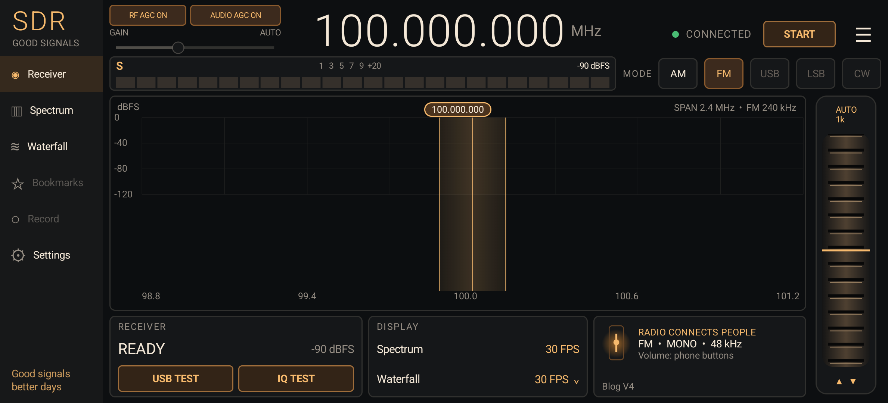

# Радиола ? SDR для Android

Приложение SDR приёмника для Android с подключением RTL-SDR Blog V4 по USB OTG.
Интерфейс написан на Kotlin и Jetpack Compose, драйвер и обработка сигнала — на C++ через Android NDK.



## Что работает

- Встроенный драйвер RTL-SDR Blog V4: внешний SDR Driver не требуется.
- Непрерывный поток IQ 2,4 MSPS.
- WFM и AM с монофоническим звуком 48 кГц, переключение во время приёма.
- Спектр с частотой обновления 30 кадров/с и водопад с выбором 30 или 60 кадров/с.
- Отображение полосы приёма на спектре и водопаде: WFM 240 кГц, AM 12 кГц.
- Вертикальный валкодер с инерцией, ручным шагом 1 кГц–1 МГц и режимом AUTO до 500 кГц.
- RF AGC, ручное усиление тюнера и AUDIO AGC для AM и FM.
- Сохранение настроек усиления, шага настройки и частоты обновления водопада.
- Ландшафтный интерфейс, скрытые системные панели и включённый экран во время работы.

USB, LSB, CW, избранное и запись пока не реализованы. Масштаб спектра и улучшение водопада находятся в планах.

## Сборка

Откройте корень проекта в Android Studio и выполните синхронизацию Gradle.
Нужны Android SDK Platform 37, NDK `28.2.13676358` и CMake.
Для запуска используйте JDK из установленной Android Studio. Gradle daemon настроен на JVM 25
в `gradle/gradle-daemon-jvm.properties`; Gradle может загрузить её автоматически.
Gradle Wrapper включён в проект.

В Windows:

```powershell
$env:JAVA_HOME = 'C:\Program Files\Android\Android Studio\jbr'
.\gradlew.bat :app:assembleDebug
```

В Linux и macOS:

```sh
./gradlew :app:assembleDebug
```

APK появится в `app/build/outputs/apk/debug/app-debug.apk`.
Минимальная версия Android — 8.0 (API 26). Для приёма нужен телефон с USB Host и донгл через OTG.
После подключения предоставьте приложению разрешение на доступ к USB и нажмите START.

## Структура

- `app/src/main/java/com/example/sdr` — интерфейс, сессия приёмника, настройки и вывод звука.
- `app/src/main/cpp` — JNI, демодуляторы WFM/AM и AUDIO AGC.
- `app/src/main/cpp/third_party` — исходники RTL-SDR Blog и libusb.
- `app/src/test/cpp` — тесты AM демодуляции и AUDIO AGC на синтетических сигналах.

## Встроенные библиотеки

Версии, изменения и лицензии зависимостей перечислены в [THIRD_PARTY.md](THIRD_PARTY.md).
Тексты лицензий библиотек сохранены рядом с их исходниками.

## DSP tests

В Windows подключите телефон или эмулятор по ADB и запустите:

```powershell
.\scripts\Run-DspTests.ps1
```

Скрипт генерирует DSP-профили, компилирует 16 нативных программ через NDK проекта
с оптимизацией `-O3` и включёнными assertions, затем запускает их на Android.
RF-сигнал для тестов синтетический, подключать донгл не требуется.
Проверяются фильтрация алиасов, полосы, все модуляции, стерео, перестройка,
AGC, шумодав, управление усилением и настоящий код HF-тюнера с моделью I²C.
В тесте HF ожидаются сообщения `i2c wr failed=-5`: намеренно проверяется восстановление после ошибки.
Ненулевой код компилятора или теста прерывает прогон.

При нескольких устройствах укажите `-Serial <adb-serial>`.
SDK берётся из `ANDROID_HOME` либо `%LOCALAPPDATA%\Android\Sdk`;
версия NDK читается из `app/build.gradle.kts`.
Архитектура выбирается по ABI устройства; поддерживаются arm64, ARMv7, x86 и x86_64.

```powershell
# Сравнение со старым DSP из коммита: извлекает только исходники в app/build.
.\scripts\Run-DspTests.ps1 -BaselineRevision 1e1febc
# Проверка варианта без NEON.
.\scripts\Run-DspTests.ps1 -Scalar -TestNames anti_alias_test
```

Параметры полос и коэффициенты задаются в `app/src/main/dsp/profiles.json`.
Сгенерированные Kotlin/C++ файлы в `app/build/generated/dsp` вручную не редактируются.
Требования к фильтру и результаты сравнения записаны в [плане улучшений](docs/IMPROVEMENT_PLAN.md).

Проверки управления приёмником и физики валкодера запускаются без телефона:

```powershell
.\gradlew.bat :app:testDebugUnitTest
```

`ReceiverControllerTest` моделирует блокирующие аппаратные вызовы, отмену START,
приоритет STOP, потерю USB, объединение настроек и устаревшие ответы.

`AudioRecoveryTest` проверяет ограничение попыток восстановления и зависшие записи.
`audio_queue_policy_test` проверяет порог 120 мс и переполнение счётчика кольцевой очереди.

Проверки жизненного цикла и audio focus требуют телефона с разрешённым USB-доступом к RTL-SDR.
После сборки можно запустить их напрямую, сохранив установленное приложение:

```powershell
.\gradlew.bat :app:assembleDebug :app:assembleDebugAndroidTest
$adb = "$env:LOCALAPPDATA\Android\Sdk\platform-tools\adb.exe"
& $adb install -r app/build/outputs/apk/debug/app-debug.apk
& $adb install -r app/build/outputs/apk/androidTest/debug/app-debug-androidTest.apk
& $adb shell am instrument -w -r com.example.sdr.test/androidx.test.runner.AndroidJUnitRunner
```

Перед запуском откройте приложение и разрешите доступ к донглу; без устройства/разрешения
аппаратные тесты пропускаются. Прямой запуск оставляет приложение установленным.
Для Gradle-прогонов также задано `android.injected.androidTest.leaveApksInstalledAfterRun=true`.
Уведомление активного приёма позволяет остановить его в фоне. Потеря audio focus или
отключение наушников останавливает приём; возобновление выполняется кнопкой START.

## Channel bandwidth

Кнопка BW между модуляциями и STEREO меняет реальную полосу DSP. Меню содержит
Default, набор ширин для выбранной модуляции и Custom. В Custom ширина вводится
в кГц, например `6.7` или `6,7`. Выбор сохраняется отдельно для каждого режима;
Default удаляет переопределение текущего режима и возвращает ширину из профиля.
Границы на спектре/водопаде и область измерения сигнала учитывают выбранную ширину.
Для USB/LSB нижняя звуковая граница остаётся 150 Гц. Полоса захвата USB — 2,4 МГц.

Допустимые диапазоны и пресеты заданы в `app/src/main/dsp/profiles.json`.
Пересчёт FIR выполняется только при смене полосы, история IQ сохраняется.
`channel_bandwidth_test` проверяет избирательность AM/WFM/CW и сохранение истории;
`ChannelBandwidthTest` — диапазоны, отображение значений и границы боковых полос.

## Spectrum and waterfall

Новые данные спектра и водопада обновляются на 30 FPS. FFT работает в отдельном
потоке с одним ожидающим заданием: устаревшее заменяется свежим. Обработка IQ
и демодуляция продолжаются с полной скоростью 2,4 MSPS.

История водопада принадлежит ViewModel и сохраняет полную полосу каждой строки,
её частоту и время. Открытие Settings не очищает историю. При зуме и перестройке
каждая строка рисуется в своих RF-координатах.

`WaterfallHistoryTest` проверяет данные/координаты истории;
`latest_frame_mailbox_test` — замену кадра, владение буфером и остановку очереди.
Инструментальные тесты проверяют также Settings и реальное изображение старого
сигнала после зума. Диагностические времена доступны в logcat с тегом `ReceiverVisual`.
